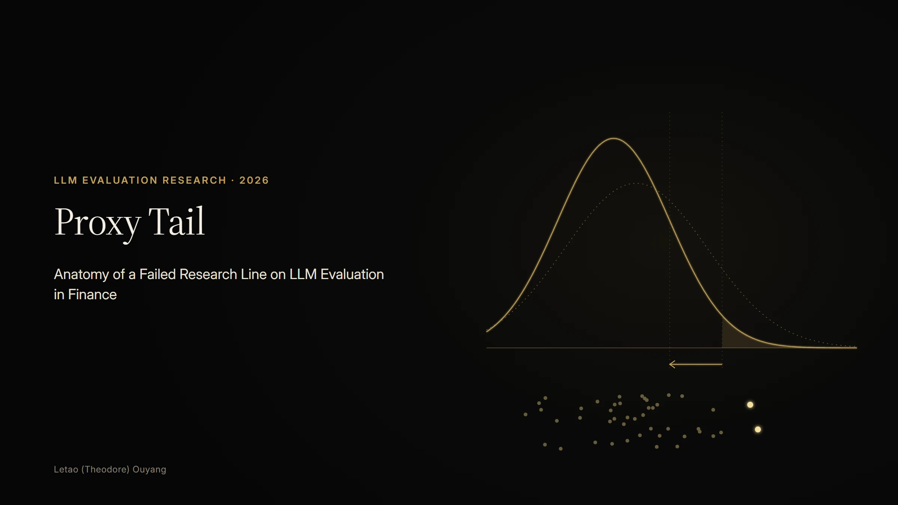
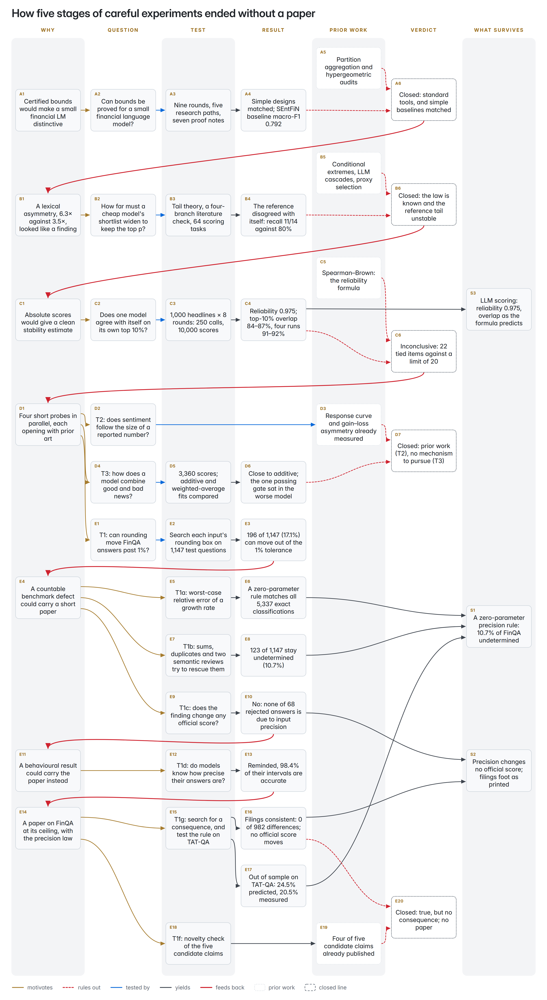
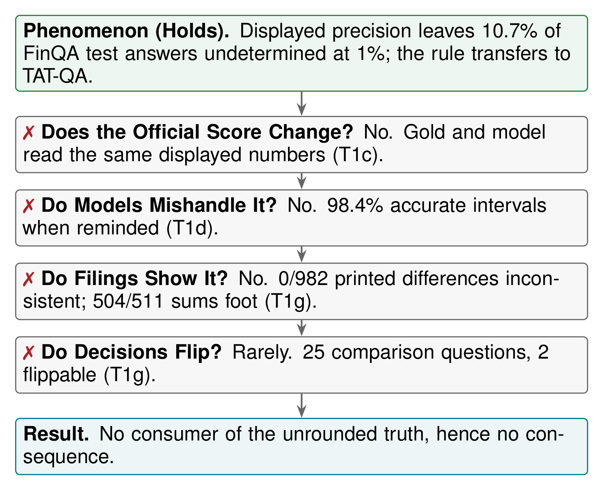

# Proxy Tail: Anatomy of a Failed Research Line on LLM Evaluation in Finance

**Letao (Theodore) Ouyang** · Independent research · November 2026

[Report](report/Proxy-Tail-Anatomy-of-a-Failed-Research-Line-on-LLM-Evaluation-in-Finance.pdf) · [LaTeX source](report/src/) · [Research record](research/README.md) · [Reproduce](REPRODUCE.md)

**Why did five stages of careful experiments end without a paper, and how early could each stage have been closed?**

I set out to find a result on LLM evaluation in finance strong enough for a top NLP venue. I tried
five directions in turn: certified financial language models, tail screening with a cheap model, the
self-stability of LLM scores, two behavioural probes, and the rounding precision of financial
question answering. Each one ran into a wall. The idea was already known, the effect changed nothing
anyone acts on, or the instrument could not resolve the question. I closed the line and kept the
complete record: every protocol, prompt, raw model output, analysis script and pre-registered gate.
The report explains why the line failed, what survives, and how each stage could have been closed at
a fraction of the cost. **Status: closed.**

## The research route

<picture>
  <source media="(prefers-color-scheme: dark)" srcset="assets/route-dark.png">
  
</picture>

Each stage runs along a row, from the belief that opened it to its verdict; the red links that run
backwards are the turns of the route. Dotted boxes are prior work and grey dashed boxes are lines
that closed. Figure 1 of the report draws the same route stage by stage, with the reason for each
turn beside its arrow.

The [research route](docs/research-route.md) explains all 48 steps and all 52 links.

## Why the line failed

A result at the level I aimed for needs three conditions at once: it must be **new**, it must have
a **consequence** that some reader would act on, and its **evidence** must be complete. Every stage
failed on novelty or consequence; the only condition the line reliably delivered was evidence. This
is not a coincidence. Novelty and consequence are cheap to test (hours of reading), evidence is
expensive (thousands of model calls), and a sound plan tests the cheap conditions first. An
automated experiment pipeline made evidence nearly free to *start*, so each stage began with an
experiment and ended with a novelty or consequence check. The report traces this single root cause
through its three forms (**method before phenomenon**, **novelty checked late**, and **count before
consequence**) and shows, with the line's own data, the earliest signal that could have closed each
stage and how little it would have cost to read it.

A concrete example. The rounding line (Stage E) measured a real effect: for about one FinQA test
question in ten, the precision printed in the filing cannot pin the answer down to the benchmark's
1% tolerance. More than 1,500 model sessions later, it was clear that this changes no official
score. The reason is visible in the benchmark's definition: the gold answer is a program run on the
displayed numbers, and models read the same displayed numbers. Uncertainty about the *unrounded*
truth is invisible to every score that shares that convention. Reading the scorer would have shown
this before the first experiment.

## Practical significance

A positive result tells readers that one path works. A well-documented failure tells them which
paths do not, why, and how cheaply they could have found out. That second kind of knowledge is the
more transferable one here.

| Audience | What this failure shows | What to do differently |
| --- | --- | --- |
| **Researchers with automated experiment pipelines** | Execution becomes cheap and the choice of question becomes the bottleneck. Cheap experiments crowd out the cheap reading that would have closed each stage; automation applies gates literally and drifts toward documentation that is easy to check. | Answer the five questions below in writing before the first experiment runs; give reading and novelty checks their own budget; write every gate with a fallback. |
| **Builders and users of financial QA benchmarks** | About 10% of FinQA test answers are not determined at 1% by the displayed inputs; a zero-parameter rule finds them and transfers to TAT-QA; filings are self-consistent at display precision. | Flag precision-undetermined items or derive item-level tolerances from displayed precision; read small differences near the accuracy ceiling with caution; do not estimate real rates with independent-rounding models. |
| **Practitioners screening financial text with LLM scores** | One run reproduces 84–87% of its own top decile; four averaged runs reach 91–92%, as the reliability formula predicts; 0–100 scales create ties at list boundaries. | Size repetition by the reliability formula; prefer averaged absolute scores to single rankings; report tie-aware list sizes. |
| **Supervisors, reviewers and funders** | Pre-registered gates, a committed prediction and a falsification test on the best finding made every negative verdict credible and fast to reach. | Ask for the cost audit and the falsification tests alongside the results; credit documented negative results as research outputs. |

## Five questions to answer before the first experiment

1. **Who consumes the answer?** Name the score, decision or price that changes if the hypothesis is
   true. For a benchmark defect, read the scorer and check that the defect passes through it.
2. **Has it been done?** Two hours on prior art, including the last twelve months of preprints and
   code repositories, searched by someone other than the proposer.
3. **What is the cheapest falsification test, and does it run first?** Write down the result that
   would end the line and run that test before anything that scales.
4. **Can the instrument resolve the gate?** From pilot data, compute granularity, ties and the
   chance that the gate passes under a plausible truth. Two of my gates could not: one failed by a
   single item out of 14, the other had a 40–70% chance of a tie breach before it ran.
5. **Is my edge decisive here?** If the mathematics is textbook and the field is crowded, expect to
   lose the race to novelty.

## Results that survive

- **A verified benchmark-precision note.** A zero-parameter rule predicts which financial-QA answers
  the displayed precision cannot determine. On FinQA, 123 of 1,147 test questions (10.7%) remain
  undetermined at 1% after duplicate disclosures, sum constraints and two independent semantic
  reviews. Out of sample on TAT-QA, the prediction committed before measuring was 24.5%; the
  measurement was 20.5%. The underlying mathematics is textbook (cancellation in a difference of
  close numbers).
- **A negative result about consequences.** This indeterminacy changes no official score: the few
  scores that precision touches (0.15% of FinQA and 0.35% of TAT-QA scored items) are all explained
  by output digits. Filings are self-consistent at their displayed precision (0 of 982 printed
  differences inconsistent; 504 of 511 sum relations foot exactly), so independent-rounding models
  should not be used to estimate real rates.
- **Measurement facts for LLM scoring.** One model scoring 1,000 financial headlines has single-run
  reliability 0.975; its top-10% list overlaps 84–87% with an independent run and 91–92% after
  averaging four runs, close to the Spearman–Brown prediction.

## Repository

| Path | Contents |
| --- | --- |
| [`report/`](report/) | The report (PDF), its LaTeX source, and PNG crops of its two figures |
| [`docs/research-route.md`](docs/research-route.md) | The route of the line as a network, node by node |
| [`research/`](research/) | One folder per stage or task: protocols, prompts, raw outputs, analysis code and results. Start with [`research/README.md`](research/README.md) |
| [`source_materials/`](source_materials/) | The data and results carried over from my earlier financial language-model project ([`130U/RESEARCH-Financial-Large-Language-Model`](https://github.com/130U/RESEARCH-Financial-Large-Language-Model)) and the FOMC source audit used in Stage A |
| [`REPRODUCE.md`](REPRODUCE.md) | How to recompute the saved results without calling any model |

**Reading guide.** Five minutes: this page. Thirty minutes: the
[report](report/Proxy-Tail-Anatomy-of-a-Failed-Research-Line-on-LLM-Evaluation-in-Finance.pdf). An
afternoon: the report, then the one-page summaries of each stage linked from
[`research/README.md`](research/README.md), then the raw records of whichever stage you doubt.

## Data and licences

The FinQA and TAT-QA datasets are downloaded by the scripts and are not stored here; excerpts that
appear in prompts and per-question records stay under the datasets' own licences (FinQA: MIT, licence
file in [`research/t1c_models/inputs/`](research/t1c_models/inputs/); TAT-QA: CC BY 4.0). SEntFiN
(MIT) is stored with its licence in
[`source_materials/130U-FinLLM/data/raw/candidates/sentfin/`](source_materials/130U-FinLLM/data/raw/candidates/sentfin/).
FOMC minutes are public records of the Federal Reserve Board.

## Citation

Letao (Theodore) Ouyang, *Proxy Tail: Anatomy of a Failed Research Line on LLM Evaluation in Finance*
(2026),
<https://github.com/130U/RESEARCH-Proxy-Tail-Anatomy-of-a-Failed-Research-Line-on-LLM-Evaluation-in-Finance/blob/main/report/Proxy-Tail-Anatomy-of-a-Failed-Research-Line-on-LLM-Evaluation-in-Finance.pdf>.
See [CITATION.cff](CITATION.cff).

[theodore.oy2025@gmail.com](mailto:theodore.oy2025@gmail.com) · [10@alumni.duke.edu](mailto:10@alumni.duke.edu)

© Letao (Theodore) Ouyang. All rights reserved.
