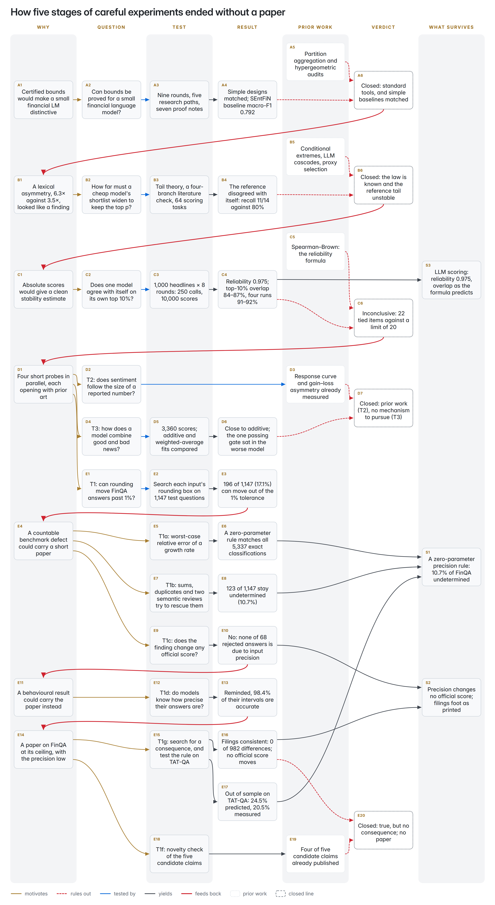

# Research route

How the program moved from stage to stage: the belief that opened each step, the question it asked, the test and
its result, the published work that closed it, and what survives. The figure draws the route of Figure 1 of the
[report](../report/Proxy-Tail-Anatomy-of-a-Failed-Research-Line-on-LLM-Evaluation-in-Finance.pdf) as a network.

<picture>
  <source media="(prefers-color-scheme: dark)" srcset="../assets/route-dark.png">
  
</picture>

## Reading the figure

Columns are kinds of step, and each stage runs along a row from the belief that opened it to its verdict. Six
links run backwards, from a verdict or a result to the belief that opened the next step: these are the turns of
the route.

| Link | Meaning |
| --- | --- |
| motivates | A belief that made the next question or test necessary |
| tested by / yields | A question and the test that checks it; a test and what it produced |
| rules out | A result or a published precedent that closed a line |
| feeds back | A verdict or a result that turned the program to its next step |

Solid boxes are steps of the program. Dotted boxes are prior work, and grey dashed boxes are lines that closed.
Each node's id gives its stage, A to E as in the report, with S for the results that survive.

## The five stages

### A. Certifiable financial language models

A1 → A2 → A3 → A4 → A6, with A5 also closing the line.

My own work gives proved intervals for quantities that cannot be observed directly, and the plan was to carry
this over to language models (A1, A2). Nine rounds of derivations produced theory that was
correct and in places sharp (A3), but every round added a stronger simple alternative that matched the elaborate
design (A4), and each component turned out to be a standard tool (A5). No real-data certificate was produced (A6).
A certificate is worth what the certified claim is worth, and nobody consumed these claims.

### B. What a cheap model misses in the tail

A6 → B1 → B2 → B3 → B4 → B6, with B5 also closing the line.

Saved lexical-model scores showed a two-sided asymmetry, a widening of 6.3× against 3.5× at the top 1% (B1), so
the program asked how far a cheap model's shortlist must widen to keep a fixed share of a reference model's top p
(B2). The law was already known from conditional extremes, LLM cascades and proxy selection (B5), and the
measurement failed before the theory could be tested: the reference model's own tail failed a stability gate,
11/14 = 78.6% against 80% (B3, B4, B6).

### C. Is the reference model stable?

B6 → C1 → C2 → C3 → C4 → C6 and S3, with C5 also closing the line.

The reference did not agree with itself, so any cheap-versus-reference gap was uninterpretable, and the next step
measured its test–retest stability with absolute scores (C1, C2). One thousand headlines over eight rounds gave
single-run reliability 0.975 and top-10% overlaps within 3.3 percentage points of the reliability formula (C3, C4).
The verdict was inconclusive under the pre-registered tie gate, and even a clean pass would only have confirmed the
Spearman–Brown formula (C5, C6). The measurements themselves survive (S3).

### D. Two behavioural probes

C6 → D1 → D2 → D3 → D7, and D1 → D4 → D5 → D6 → D7.

Four short probes were issued in parallel, each beginning with a prior-art step (D1); T4 was not run. T2 stopped at
prior art with zero scoring calls (D2, D3). T3 found combination close to additive, and its only passing gate was a
weight estimated inside a model that fitted twice as badly (D4 to D6), so no mechanism remained to pursue (D7).

### E. Rounding precision in FinQA

D1 → E1 → E2 → E3 → E4 → E5 to E10 → E11 → E12 → E13 → E14 → E15 to E19 → E20.

T1 found a countable effect on its first pass: 196 of 1,147 test questions (17.1%) can move out of the 1% tolerance
(E1 to E3). It became the only live line (E4), and T1a to T1c ran in parallel to explain it, to try to falsify it
and to look for its effect on scores (E5 to E10). The count survived its own falsification test, and no official
score changed. After that null, a behavioural result was tried (E11 to E13): models handle precision when asked,
and a short paper was drafted around the benchmark-side rejections (E14). The novelty check found prior work for
four of its five candidate claims (E18, E19), the search for a consequence found none of substance (E15, E16), and the rule held
out of sample on TAT-QA (E17). The line closed with no paper (E20). T1e was planned and not run.

## What survives

Three results outlast the program: a zero-parameter rule that predicts which FinQA answers the displayed precision
cannot determine (S1), the finding that this indeterminacy changes no official score (S2), and reliability
estimates for LLM scoring of financial text (S3). [Results that survive](../README.md#results-that-survive) in the
README states each with its numbers.

## Every node

| Node | Column | What it is |
| --- | --- | --- |
| **A1** Certified bounds would make a small financial LM distinctive | Why | The belief behind Stage A. My own work gives proved intervals for quantities that cannot be observed directly, and the plan was to carry this over to language models. |
| **B1** A lexical asymmetry, 6.3× against 3.5×, looked like a finding | Why | With word and character TF-IDF as reference and proxy (correlation 0.92), the widening needed at the top 1% was 6.3× on the positive side and 3.5× on the negative side, against a Gaussian 3.0×. |
| **C1** Absolute scores would give a clean stability estimate | Why | The next step measured the reference's test–retest stability first, with absolute scores instead of rankings. |
| **D1** Four short probes in parallel, each opening with prior art | Why | With the tail line closed, four short probes (T1–T4) were issued in parallel, each beginning with a prior-art step. T4 was not run. |
| **E4** A countable benchmark defect could carry a short paper | Why | T1 found a concrete, countable effect (17.1%) on its first pass and became the only live line. |
| **E11** A behavioural result could carry the paper instead | Why | After the null of T1c, a behavioural result ('models ignore precision') could carry the paper. |
| **E14** A paper on FinQA at its ceiling, with the precision law | Why | Four model runs scored 81–83% and were rejected on the same items; a short paper was drafted around this and the precision law. |
| **A2** Can bounds be proved for a small financial language model? | Question | Contamination, numeric sensitivity and audit budget, as a certificate chain: construction guarantees structure, a finite audit gives a coverage statement, and a bound carries the remaining uncertainty to the final statistic. |
| **B2** How far must a cheap model's shortlist widen to keep the top p? | Question | If a cheap model screens texts for an expensive reference, how wide must its shortlist be to keep a fixed share γ of the reference's top p? Under a conditional-extremes model, q_γ(p) = p^(α+o(1)), with α = ρ² in the Gaussian case. |
| **C2** Does one model agree with itself on its own top 10%? | Question | Before comparing models, measure how well one model agrees with itself on its own top list, and whether averaging repeated scores helps as the Spearman–Brown formula predicts. |
| **D2** T2: does sentiment follow the size of a reported number? | Question | Whether a model's sentiment responds smoothly to the size of a reported number. |
| **D4** T3: how does a model combine good and bad news? | Question | How a model combines a good and a bad fact in one headline. |
| **E1** T1: can rounding move FinQA answers past 1%? | Question | Financial filings print rounded numbers; FinQA scores answers computed from them with a 1% tolerance. For how many questions does the displayed precision fail to determine the answer within that tolerance? |
| **A3** Nine rounds, five research paths, seven proof notes | Test | Audited information sets, numeric sensitivity, audit-design budgets, dependence-robust deployment risk and proof-carrying numeric reasoning, with 125 unit tests. The literature check stopped at 12 of 32 planned questions because the stage ran offline. |
| **B3** Tail theory, a four-branch literature check, 64 scoring tasks | Test | 64 scoring tasks over 288 lexical families. One model ranked the same 128 headlines twice, and a fresh confirmation set of 128 headlines carried eight pre-registered checks. |
| **C3** 1,000 headlines × 8 rounds: 250 calls, 10,000 scores | Test | Each headline scored on a 0–100 scale in eight independent rounds: 8,000 main scores plus 2,000 for a same-batch control. |
| **D5** 3,360 scores; additive and weighted-average fits compared | Test | 92 calls. Held-out fits of an additive model, simple averaging and a weighted average with a negativity weight. |
| **E2** Search each input's rounding box on 1,147 test questions | Test | For each test question, look for a value inside the inputs' rounding box that moves the gold program's output out of the 1% tolerance. |
| **E5** T1a: worst-case relative error of a growth rate | Test | For a growth rate g computed from two numbers that differ by Δ last-digit units, the worst-case relative error is R = (1 + g/2)/(Δ − \|g\|/2), so the two numbers must differ by roughly 100 units before a growth rate is accurate to 1%. |
| **E7** T1b: sums, duplicates and two semantic reviews try to rescue them | Test | 511 sum relations and 21 duplicate disclosures, then a semantic review and a second, independent model-based review. |
| **E9** T1c: does the finding change any official score? | Test | 392 questions in independent model sessions, with a witness and a control condition. |
| **E12** T1d: do models know how precise their answers are? | Test | Three prompt conditions × 392 questions, an independent rerun and two review rounds. |
| **E15** T1g: search for a consequence, and test the rule on TAT-QA | Test | Printed differences, sum relations, official scores on FinQA and TAT-QA, comparison questions, and a prediction for TAT-QA committed before any TAT-QA computation. |
| **E18** T1f: novelty check of the five candidate claims | Test | An independent search of the literature for each of the five candidate claims of the drafted paper. |
| **A4** Simple designs matched; SEntFiN baseline macro-F1 0.792 | Result | The structured audit beat the strongest simple rectangle design in 9 of 20 settings with a median gain of zero; once randomised designs were allowed, a simple random census of whole layers was optimal. Real baseline on 14,284 SEntFiN entity rows: word TF-IDF 0.792, character TF-IDF 0.755, entity-only 0.534. No real-data certificate was produced. |
| **B4** The reference disagreed with itself: recall 11/14 against 80% | Result | Two negative top-10% lists of 12 and 14 items shared one item. Averaging four rankings removed most of the instability, but one of eight pre-registered checks failed on the confirmation set: negative-tail recall 11/14 = 78.6% against an 80% gate. |
| **C4** Reliability 0.975; top-10% overlap 84–87%, four runs 91–92% | Result | Single-run reliability 0.975. The top-10% overlap between independent runs was 84–87% for one run and 91–92% for the mean of four, within 3.3 percentage points of the Gaussian prediction (84.3%, 88.8% and 92.1% for one, two and four runs). In two of the eight rounds, 22 items were tied at the positive 10% boundary, above the pre-registered limit of 20. |
| **D6** Close to additive; the one passing gate sat in the worse model | Result | Held-out RMSE 5.2 points for the additive model against 12.1 for simple averaging. The only pre-registered gate that passed, a negativity weight λ = 2.69, was estimated inside a weighted-average model whose error was twice that of the additive one. |
| **E3** 196 of 1,147 (17.1%) can move out of the 1% tolerance | Result | 196 of 1,147 test questions have a value inside the inputs' rounding box that moves the answer out of the 1% tolerance. |
| **E6** A zero-parameter rule matches all 5,337 exact classifications | Result | The first-order rule agreed with the exact classification on all 5,337 questions to which it applied; on growth-rate questions its prior prediction was 41.5% against 40.5% measured. |
| **E8** 123 of 1,147 stay undetermined (10.7%) | Result | Sums and duplicates rescued one question and semantic review removed 56 more, leaving 139 (12.1%); the second review left 123 that both reviews accepted. |
| **E10** No: none of 68 rejected answers is due to input precision | Result | Gold programs and models read the same displayed numbers, and none of the 68 answers that the official scorer rejected could be attributed to input precision alone. |
| **E13** Reminded, 98.4% of their intervals are accurate | Result | Unprompted, the digits models print are unrelated to true precision (Spearman 0.02); reminded that inputs are rounded, 98.4% of their intervals are accurate and 99.7% of their 1% calls are correct, and teaching the rule adds nothing. Two model-based reviews attributed most rejections to the benchmark side. |
| **E16** Filings consistent: 0 of 982 differences; no official score moves | Result | None of 982 printed differences disagreed with the difference of the printed levels, where an independent-rounding model predicted about a quarter; 7 of 511 sum relations had a non-zero residual. The scores that precision touches, 5 of 3,265 (0.15%) on FinQA and 16 of 4,524 (0.35%) on TAT-QA, are all explained by output digits. Only 25 questions compare two computed quantities, and 2 can flip. |
| **E17** Out of sample on TAT-QA: 24.5% predicted, 20.5% measured | Result | A prediction committed before any TAT-QA computation said 24.5% of 5,261 questions would be affected; the measured rate was 20.5%, and the first-order rule agreed with the exact classification on every question. |
| **A5** Partition aggregation and hypergeometric audits | Prior Work | Partition aggregation (Levine and Feizi, 2021), hypergeometric audits and monotone heads: each component of the certificate chain. |
| **B5** Conditional extremes, LLM cascades, proxy selection | Prior Work | α = ρ² for the Gaussian is in Heffernan and Tawn (2004, §8.6); selection on a correlated proxy goes back to Taylor and Russell (1939); copula models of LLM cascades (Zellinger and Thomson, 2025) and recall-targeted proxy selection (Kang et al., 2020; Zeighami et al., 2025) cover the applied side. |
| **C5** Spearman–Brown: the reliability formula | Prior Work | Spearman (1910) and Brown (1910): how averaging repeated scores raises reliability. |
| **D3** Response curve and gain–loss asymmetry already measured | Prior Work | Marks and Vollberg (2026) had measured the core response curve and the gain–loss asymmetry. |
| **E19** Four of five candidate claims already published | Prior Work | Benchmark-side errors and shared failures (Tang et al., 2025; Stanishevskii et al., 2026), conflicts between FinQA's written answer and its program output (EnvCommons, 2026), interval elicitation on FinQA (Bahaj et al., 2025), and rounded values recovered from duplicate disclosures and sum constraints (XBRL International, 2023; Dandekar, 2010). |
| **A6** Closed: standard tools, and simple baselines matched | Verdict | Every component was a standard tool, and the strongest simple baselines matched the elaborate audit designs. Nobody asked who would use a certified macro-F1 interval. |
| **B6** Closed: the law is known and the reference tail unstable | Verdict | The theory was known, and the measurement failed before the theory could be tested. The theory work added one correct, small point: α = 1 does not guarantee a bounded widening factor. |
| **C6** Inconclusive: 22 tied items against a limit of 20 | Verdict | The formal verdict was inconclusive under the pre-registered tie gate. Even a clean pass would only have said 'use the reliability formula', a known rule. |
| **D7** Closed: prior work (T2), no mechanism to pursue (T3) | Verdict | T2 stopped at prior art with zero scoring calls; T3 left no mechanism to pursue. |
| **E20** Closed: true, but no consequence; no paper | Verdict | One verified benchmark-precision note, a set of documented negative results, no paper. The FinQA line is dropped. |
| **S3** LLM scoring: reliability 0.975, overlap as the formula predicts | What Survives | One model scoring financial headlines on a 0–100 scale has single-run reliability 0.975; its top-10% list overlaps 84–87% with an independent run and 91–92% after averaging four runs, close to the Spearman–Brown prediction. |
| **S1** A zero-parameter precision rule: 10.7% of FinQA undetermined | What Survives | A zero-parameter rule predicts which financial-QA answers the displayed precision cannot determine: 123 of 1,147 FinQA test questions (10.7%) at 1%, confirmed out of sample on TAT-QA. |
| **S2** Precision changes no official score; filings foot as printed | What Survives | The indeterminacy changes no official score: the few scores that precision touches are all explained by output digits. Filings are self-consistent at their displayed precision, so independent-rounding models should not be used to estimate real rates. |

## Every link

| # | From | To | Link | Why |
| ---: | --- | --- | --- | --- |
| 1 | A1 | A2 | motivates | The stage started from a method I am good at and looked for something to bound |
| 2 | A2 | A3 | tested by | Derivations, implementations and internal reviews, round by round |
| 3 | A3 | A4 | yields | Every round added a stronger simple alternative and one real baseline |
| 4 | A4 | A6 | rules out | Simple baselines kept matching the elaborate design |
| 5 | A5 | A6 | rules out | Each component turned out to be a standard tool |
| 6 | A6 | B1 | feeds back | A certificate is worth what the certified claim is worth, and nobody consumed these claims; certificates and training were dropped |
| 7 | B1 | B2 | motivates | A question from my own work, deciding on a cheap proxy: what does a cheap model miss in the tail? |
| 8 | B2 | B3 | tested by | Theory first, then a literature check and the scoring tasks |
| 9 | B3 | B4 | yields | The measurement failed before the theory could be tested |
| 10 | B4 | B6 | rules out | The reference's own tail failed a stability gate |
| 11 | B5 | B6 | rules out | The law is already in the conditional-extremes and proxy-selection literature |
| 12 | B6 | C1 | feeds back | The reference model did not agree with itself, so any cheap-versus-reference gap was uninterpretable |
| 13 | C1 | C2 | motivates | Measure the reference before comparing anything with it |
| 14 | C2 | C3 | tested by | Eight independent rounds on one thousand headlines |
| 15 | C3 | C4 | yields | Reliability, overlaps and tie counts from the per-item records |
| 16 | C4 | C6 | rules out | 22 items tied at the boundary in two rounds breached the pre-registered tie gate |
| 17 | C5 | C6 | rules out | A clean pass would only have confirmed a textbook formula |
| 18 | C4 | S3 | yields | The measurements hold whatever the gate decided |
| 19 | C6 | D1 | feeds back | Even a clean pass would have said 'use the reliability formula', so the tail line was closed |
| 20 | D1 | D2 | motivates | A probe of how sentiment responds to numbers |
| 21 | D1 | D4 | motivates | A probe of how mixed news is combined |
| 22 | D1 | E1 | motivates | A probe of the precision of financial question answering |
| 23 | D2 | D3 | tested by | The prior-art step ran first and stopped the task with zero scoring calls |
| 24 | D3 | D7 | rules out | The response curve and the asymmetry were already published |
| 25 | D4 | D5 | tested by | Competing models of combination, fitted and compared out of sample |
| 26 | D5 | D6 | yields | Held-out error of each model and the pre-registered gates |
| 27 | D6 | D7 | rules out | A weight inside a model that fits twice as badly is not a mechanism |
| 28 | E1 | E2 | tested by | Every input's rounding box, question by question |
| 29 | E2 | E3 | yields | A concrete, countable effect on the first pass |
| 30 | E3 | E4 | feeds back | T1 became the only live line |
| 31 | E4 | E5 | motivates | Explain the count |
| 32 | E4 | E7 | motivates | Try to falsify it |
| 33 | E4 | E9 | motivates | Look for its effect on scores |
| 34 | E5 | E6 | yields | A closed-form error bound and a first-order rule |
| 35 | E7 | E8 | yields | The finding survived its own falsification test |
| 36 | E6 | S1 | yields | The rule that predicts which answers are undetermined |
| 37 | E8 | S1 | yields | The verified count |
| 38 | E9 | E10 | yields | Gold programs and models read the same displayed numbers |
| 39 | E10 | S2 | yields | The first link of the consequence chain is broken |
| 40 | E10 | E11 | feeds back | After the null, the next candidate was a behavioural result |
| 41 | E11 | E12 | motivates | Ask the models directly |
| 42 | E12 | E13 | yields | Models handle precision when asked |
| 43 | E13 | E14 | feeds back | Benchmark-side rejections dominated, and a short paper was drafted around them |
| 44 | E14 | E18 | motivates | Novelty first |
| 45 | E14 | E15 | motivates | Then a search for a consequence |
| 46 | E15 | E16 | yields | Printed differences, sum relations and official scores |
| 47 | E15 | E17 | yields | A prediction committed before any TAT-QA computation |
| 48 | E16 | S2 | yields | No consumer of the unrounded truth, and tables that foot |
| 49 | E17 | S1 | yields | The rule holds out of sample |
| 50 | E16 | E20 | rules out | No consumer of the unrounded truth, hence no consequence |
| 51 | E18 | E19 | yields | Four of five candidates fell after a single focused search |
| 52 | E19 | E20 | rules out | Only the rule and the exact count remained |
