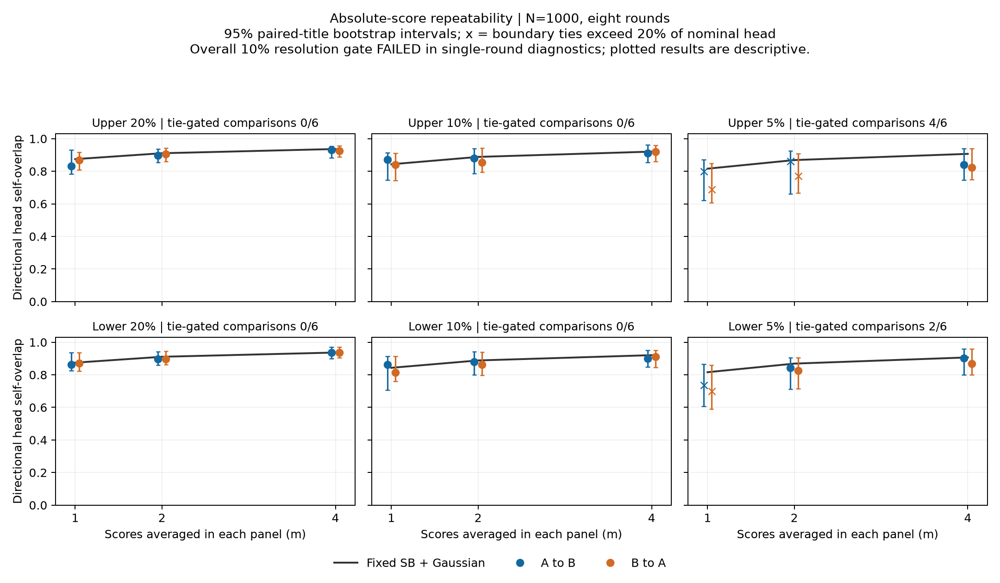

# Top-list stability of the same model

2026-11-16. **The experiment was executed in full. The formal conclusion is "inconclusive", because the pre-registered main ties gate failed.** With four-score averages, the 10% two-tail overlap point estimates reach 90% in this sample; this cannot be used to change the verdict to a protocol pass or to derive a new tail law.

## What was actually done

After I chose to continue scoring as a replication and stress test, 1,000 families were drawn with the frozen seed, one item per family, from the 1,282 test lexical families not used in the earlier three ranking experiments. Fixed 0–100 integer scale, five synthetic anchors, 40 items per batch, with batches and order re-randomized each round. The scorer was gpt-6-sol with reasoning_effort=low and fork_turns=none, and every call opened a new scoring context.

The 200 calls of the main experiment produced 8,000 scores. The 100 control targets are spread over all 25 first-round batches, so the two control repeats took 50 calls in total and produced 2,000 companion scores. Only the 200 scores of the pre-selected targets are used in the main control comparison; the other 1,800 scores are still saved in full. In total there were 250 distinct scoring-agent tasks and 10,000 raw scores. All outputs passed the ID, duplicate-key and integer-range checks on the first pass, with zero scoring retries. The recorded collection time runs from 14:36:37 to 15:49:41 UTC, about 73.1 minutes including scheduling waits; it cannot be read as pure inference time.

Midway, the scheduler twice reported Bad Request on a request. I kept the completed scores and scheduled round eight directly, without rerunning any valid scores. Maximum concurrency changed from two scoring sessions to three; model and prompt were unchanged. During a field check, one source row carrying an old label was displayed. Neither the random sampling nor the scoring used that label, but we cannot claim that no participating session ever saw the labels.

The source is the saved version of SEntFiN, used under its authors' MIT license and the local research scope. The source version, the limits of the existing split, the family sampling seed and the exact implementation rules are in the [frozen protocol](protocol.md). The original text of the new headlines is stored outside the repository; this round's commit contains only ID mappings, scores, synthetic prompts, code and summaries. Lexical-family deduplication does not prove that events are independent, nor that pretraining never saw the headlines.

## Main results: 10% two tails

A is rounds 1–4 and B is rounds 5–8. For each group, we take the mean of the raw integer scores over the same prefix of m=1, 2, 4 rounds. A→B uses A's list as the reference denominator; B→A is the reverse. All boundary ties are kept, so the two actual lists can differ in size. The ranges in the table below are the point estimates from the two directions, not confidence intervals.

| Number of averaged scores m | Top 10% overlap | Bottom 10% overlap | Fixed Gaussian prediction (same for both tails) |
|---|---:|---:|---:|
| 1 | 84.1%–87.2% | 81.3%–86.1% | 84.3% |
| 2 | 85.6%–88.1% | 86.3%–88.0% | 88.8% |
| 4 | 91.1%–92.0% | 90.1%–91.0% | 92.1% |

For single scores and two-score averages, none of the point estimates in the four main directions reaches 90%. For four-score averages, all four point estimates reach 90% for the first time. But the item-wise interval lower bounds for four-score averages are about 84.5%–86.1%, so we cannot claim that the population reaches 90% or is guaranteed to, nor infer that the minimum sufficient number of repeats is exactly four.

| m | Tail | Reference direction | Intersection / reference size | Overlap | 95% interval | Prediction | 95% interval of observed minus predicted |
|---|---|---|---:|---:|---|---:|---|
| 1 | Positive | A→B | 95/109 | 87.2% | [74.8%, 91.5%] | 84.3% | [-9.4%, 7.4%] |
| 1 | Positive | B→A | 95/113 | 84.1% | [74.4%, 91.3%] | 84.3% | [-9.7%, 7.2%] |
| 1 | Negative | A→B | 87/101 | 86.1% | [70.8%, 91.3%] | 84.3% | [-13.2%, 7.3%] |
| 1 | Negative | B→A | 87/107 | 81.3% | [76.1%, 91.4%] | 84.3% | [-8.2%, 7.4%] |
| 2 | Positive | A→B | 89/101 | 88.1% | [78.5%, 94.0%] | 88.8% | [-10.1%, 4.9%] |
| 2 | Positive | B→A | 89/104 | 85.6% | [79.6%, 94.1%] | 88.8% | [-9.1%, 5.4%] |
| 2 | Negative | A→B | 88/100 | 88.0% | [80.0%, 94.1%] | 88.8% | [-8.7%, 5.5%] |
| 2 | Negative | B→A | 88/102 | 86.3% | [79.8%, 94.0%] | 88.8% | [-8.9%, 5.0%] |
| 4 | Positive | A→B | 92/101 | 91.1% | [85.5%, 96.1%] | 92.1% | [-6.6%, 4.4%] |
| 4 | Positive | B→A | 92/100 | 92.0% | [86.1%, 96.1%] | 92.1% | [-6.0%, 4.3%] |
| 4 | Negative | A→B | 91/101 | 90.1% | [84.8%, 95.0%] | 92.1% | [-7.2%, 3.1%] |
| 4 | Negative | B→A | 91/100 | 91.0% | [84.5%, 95.0%] | 92.1% | [-7.6%, 3.2%] |

The intervals are from a 5,000-draw headline-paired percentile bootstrap. Each draw carries all eight rounds of scores for the same headline and keeps the multiplicity of observations drawn more than once; the predicted correlation and the observed-minus-predicted value are recomputed in the same resample. These are item-wise intervals conditional on the calls already made. They are not simultaneous intervals, and they do not cover the uncertainty from all future batches or service changes.

## Why the resolution gate failed

The frozen protocol states: if the whole tie group at any main 10% single-round or mean-score boundary exceeds 20% of the nominal 100, the overall main conclusion is inconclusive. In rounds six and seven, the upper-tail boundary at score 76 has **22 items** tied each time, which brings the actual list size to **118 and 117**. The extra expansion is only 18 and 17, but the check is on the whole 22-item tie group; the "extra expansion fraction" from the earlier experiment cannot replace the definition used here.

The number of distinct score values used in each round was 77, 78, 79, 79, 80, 79, 79, 78. For two-score means the two panels have 145 and 147, and for four-score means 275 and 270. The higher resolution is a real observation, but it does not remove the frozen single-round gate. Several boundaries also fail at 5%; the full record is in [boundaries.csv](results/boundaries.csv). The 84 check cells in the results JSON double-count single rounds and panel m=1, so the 11 failing cells cannot be treated as 11 independent failures.

The six 10% mean-comparison points in the figure carry no failure marker themselves, because they use the specified panel prefixes. The overall gate additionally checks the eight single rounds, and the failure comes from rounds six and seven. The note at the top of the figure states this difference explicitly. The excess is a limited overshoot of 22 against 20. It does not prove that the scale is useless, but the threshold also cannot be relaxed after the fact.

## Comparison with the fixed formula

The mean normal-rank correlation over the 28 single-round pairs is r=0.974824, with range 0.971540–0.977704 and paired bootstrap 95% interval [0.971, 0.977]. From this, the 10% Gaussian overlap predictions for m=1, 2, 4 are 84.31%, 88.83%, 92.07%. The averaged overlaps and widening results were not used for tuning.

The maximum absolute error of the 10% overlap point estimates is 3.25 percentage points, and all twelve difference intervals contain zero; the 36 overlap difference intervals over all three values of p also all contain zero. This means "no clear deviation detected", not "the formula is proven accurate": the intervals for the main points do not all fall inside the pre-registered ±5 percentage point equivalence range. So the stopping success condition "the formula fits practically everywhere and both tails are symmetric" was not met. r and the averaged results share the same eight rounds of data, so this is an internal fixed-formula test and cannot be called an independent held-out prediction.

The widening factors were not omitted either. The factor takes the minimum number of items needed at a complete score-group boundary, divided by the nominal k=100, with the target of recovering at least 90% of the reference's actual list. So the factor can be below 1. This is not a missing denominator, and it is not a budget that is forbidden to shrink.

| m | Tail | Reference direction | Pass-through count | Widening factor | 95% interval | Predicted factor |
|---|---|---|---:|---:|---|---:|
| 1 | Positive | A→B | 127 | 1.27 | [1.100, 1.870] | 1.153 |
| 1 | Positive | B→A | 168 | 1.68 | [1.090, 1.880] | 1.153 |
| 1 | Negative | A→B | 135 | 1.35 | [1.100, 1.710] | 1.153 |
| 1 | Negative | B→A | 138 | 1.38 | [1.130, 1.620] | 1.153 |
| 2 | Positive | A→B | 110 | 1.10 | [0.970, 1.440] | 1.027 |
| 2 | Positive | B→A | 133 | 1.33 | [0.970, 1.550] | 1.027 |
| 2 | Negative | A→B | 116 | 1.16 | [1.000, 1.320] | 1.027 |
| 2 | Negative | B→A | 111 | 1.11 | [0.990, 1.340] | 1.027 |
| 4 | Positive | A→B | 100 | 1.00 | [0.930, 1.160] | 0.960 |
| 4 | Positive | B→A | 94 | 0.94 | [0.920, 1.160] | 0.960 |
| 4 | Negative | A→B | 100 | 1.00 | [0.940, 1.160] | 0.960 |
| 4 | Negative | B→A | 101 | 1.01 | [0.940, 1.180] | 0.960 |

The pass-through threshold is affected by jumps at complete score groups, so the differences in this table cannot all be attributed to tail dependence. Below are all six item-wise results whose widening-factor difference interval excludes zero, so that we do not show only the overlap metric that favors the Gaussian baseline. Four of them also fail the top-list ties gate. The other two do not amount to a systematic mismatch across m under the pre-registered main 10%, and no multiple-testing correction was applied.

| m | p | Tail | Direction | 95% interval of widening-factor difference | Top-list ties gate for this comparison |
|---|---|---|---|---|---|
| 1 | 20.0% | upper | B_to_A | [0.006, 0.250] | passed |
| 1 | 5.0% | upper | A_to_B | [0.058, 1.095] | failed |
| 1 | 5.0% | upper | B_to_A | [0.095, 1.063] | failed |
| 1 | 5.0% | lower | A_to_B | [0.186, 1.083] | failed |
| 1 | 5.0% | lower | B_to_A | [0.103, 1.447] | failed |
| 4 | 5.0% | upper | A_to_B | [0.005, 0.452] | passed |

Normal-rank reliability and raw integer score means are not on the same scale; averaging and the rank transformation do not commute. The formula was meant to be this round's falsifiable baseline. At present the remaining deviation cannot be attributed uniquely to scale, discretization, error covariance or non-Gaussian tails. For the theoretical attribution and adjacent research, see the [literature gate report](PRIOR_ART.md) and the [mathematical analysis](literature_reliability.md). Spearman–Brown and the Gaussian screening formula are not claimed as original contributions.

## Tail difference and batch sensitivity

Under the main 10%, the upper-minus-lower-tail overlap intervals contain zero for all six combinations of m and reference direction. This does not prove symmetry, and there is no evidence for a stable two-tail asymmetry. In particular, this same-model retest conclusion cannot be transferred to the tail relation between a cheap model and an expensive model.

The control comparison uses the same 100 targets: same-batch C1/C2 r=0.985240, 95% interval [0.973, 0.993]; different-batch mean over the 28 pairs of the eight rounds r=0.971317, 95% interval [0.958, 0.979]. The paired difference is 0.013922, 95% interval [0.004, 0.028]. The correlations of round 1 with C1 and with C2 are 0.987701 and 0.978335.

A fixed same-batch input goes together with a higher retest correlation, which supports batch sensitivity. The different-batch condition changes both membership and position, and session time and the underlying service were not fully controlled. So we cannot go further and assert a pure membership effect, still less call the difference between the two correlations a given percentage of the total noise. This round does not report an unidentified "batch effect is the largest share".

## 20% and 5% kept in full

| p | m | Positive overlap (both directions) | Negative overlap (both directions) | Gaussian prediction | Positive widening factor | Negative widening factor |
|---|---|---|---|---:|---|---|
| 20.0% | 1 | 83.3%–87.0% | 86.3%–87.2% | 87.5% | 1.12–1.14 | 1.10–1.18 |
| 20.0% | 2 | 89.8%–90.6% | 89.6%–89.6% | 91.1% | 1.02–1.06 | 1.06–1.07 |
| 20.0% | 4 | 92.6%–93.1% | 93.5%–93.5% | 93.7% | 0.97–1.01 | 0.96–0.97 |
| 5.0% | 1 | 69.0%–80.0% | 70.0%–73.7% | 81.6% | 1.66–1.68 | 1.82–2.14 |
| 5.0% | 2 | 77.2%–86.3% | 82.7%–84.3% | 86.9% | 1.28–1.40 | 1.22–1.28 |
| 5.0% | 4 | 82.4%–84.0% | 86.8%–90.2% | 90.7% | 1.22–1.24 | 1.06–1.12 |

These ranges are again the point estimates from the two directions. Several boundaries at 5% fail, so a new tail law cannot be built on their larger losses alone. With four-score averages, the upper-tail 5% overlap is still only about 82%–84%, and this description is kept. All directions, confidence intervals, tie status and pass-through amounts are in [tables.csv](results/tables.csv) and [results.json](results/results.json).

[Vector PDF figure](results/stability.pdf). Error bars are the observed intervals, black lines are the fixed prediction, and crosses mark comparisons whose boundary gate failed. These intervals carry no simultaneous coverage guarantee.

## Assessment and limits on next steps

This round of the experiment is fully finished, and the formal status is **inconclusive**. It provides descriptive evidence that can actually be recomputed: single-score 10% self-overlap is about 81%–87%, and four-score averages give about 90%–92%; the Gaussian point prediction for 10% overlap is close to the observed values; the fixed-context correlation is higher. It met neither the continuation gate (main single-score overlap clearly below 75%) nor the single-score success gate (above 90%) or the practical-equivalence gate, and the main ties gate has failed.

Recommendation: close the current protocol as a replication and measurement-limitation result, keep all failure reasons on record, and for now do not expand it with the same scale or upgrade it into a new theory project. As the TASK requires, do not change the scale, anchors or prompt on these 1,000 items and then re-judge a pass. If the line were to continue, the remaining research increment would have to be stated first: whether a new measurement scale can reduce discrete boundary effects on a new sample, or a separate reference target that can identify true recall and cost. High self-consistency can be stably correct or stably wrong; this experiment cannot decide real investment value or the economic value of screening.

## Files and recomputation

The [one-page summary](ONE_PAGE.md) is the entry point; [REPRODUCE.md](REPRODUCE.md) gives the analysis commands. The exact scoring prompt is in [prompt.txt](prompt.txt), the session instructions are in [agent_task_template.txt](agent_task_template.txt), the batch and source mappings are in [schedule.csv](schedule.csv), [batches.csv](batches.csv) and [sample.csv](sample.csv), the actual call records are in [calls.jsonl](calls.jsonl), and all raw scores by ID are in [raw_scores/](raw_scores/). The input reconstruction code [prepare_inputs.py](prepare_inputs.py) does not write news text to the repository; the analysis code [analyze_scores.py](analyze_scores.py) reads only ID scores.

13 synthetic tests passed; all 250 files passed the analyzer's independent read and integrity checks. The early m=1 and m=2 point estimates match the final analysis field by field. Both the 5000 main resamples and the 5000 control resamples completed, with no invalid reliability replicates. On the 3,000 midpoints of the Gaussian interpolation grid, the maximum overlap error is about 1.45e-10 and the maximum widening-factor error about 5.87e-8; this is a numerical check, not a rigorous upper bound over the continuous domain. The figure was generated and its display was checked. The extra note on the figure only clarifies the difference between the overall gate and the points shown; it does not change the statistical results.
