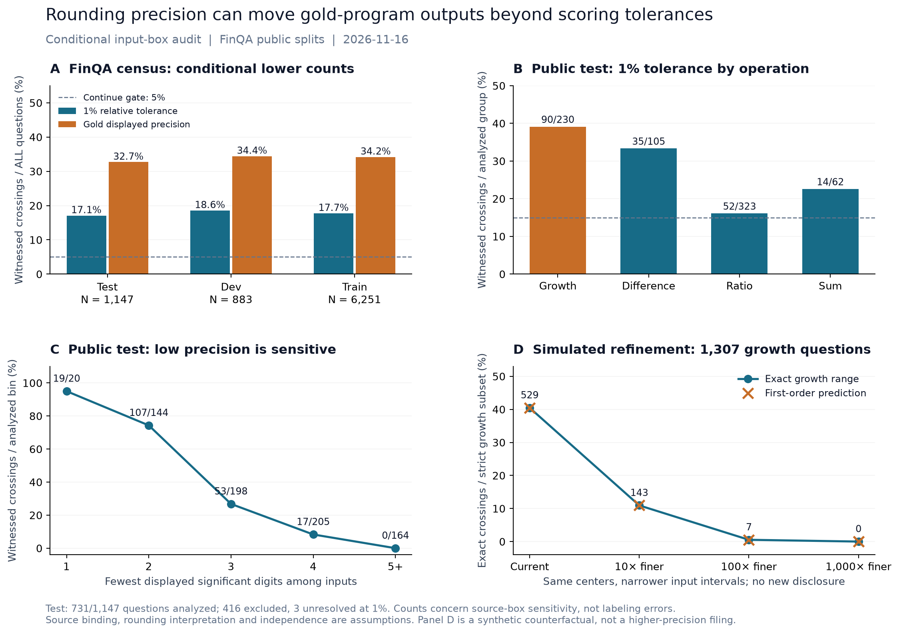

# T1: same-day research results on the rounding precision of filing inputs

Date: 2026-11-16, America/New_York. I read the research pivots, failed results and latest absolute-scoring conclusion in the earlier "research plan for building a certifiable financial language model" conversation; this task was executed independently and did not reuse the old experiments' scores or success criteria.

## 1. Conclusion, and the question it actually answers

**Continue.** On public test, 196 / 1,147 = **17.09%** of questions have a consistent input witness outside the 1% tolerance; in the growth-rate group it is 90 / 230 = **39.13%**. Both the original task's 5% overall threshold and its 15% group threshold are exceeded. The verdict does not depend on how borderline values are handled, nor on the very small "other" group.

The precise quantity studied is: given the original gold program (f), the successfully bound inputs, and independent half-a-last-digit-unit rounding boxes (B), does there exist (z\in B) such that (f(z)) falls outside the specified gold acceptance interval? Arithmetic uses exact rationals; out-of-tolerance witnesses are taken in the interior of the rounding intervals, which avoids endpoint issues with rounding ties.

It has three limits:

1. Input binding, the rounding interpretation and independent boxes are model assumptions; they have not been verified question by question. Other disclosures in the document, accounting identities or discrete constraints may shrink the feasible region. **17.09% is not a proven lower bound on the "unanswerable from the full text" rate.**
2. FinQA can reasonably treat the displayed numbers as arithmetic inputs. Changing a hidden last digit changes the economic quantity; it does not automatically make the original benchmark task unsolvable, and it does not automatically make the gold annotation wrong.
3. The gold program may not be faithful to the question. This round executes it as is and does not correct program semantics; cases where the center value and the answer disagree are handled separately. For the same reason, we did not measure model accuracy or investment value.

## 2. Prior-art check: the methods exist; no complete measurement found so far

We completed a focused targeted search, 31 sub-task search queries and supplementary queries, and verified the relevant full texts and official source code. We do not claim to have used a full half-day of wall-clock time, and we do not treat "not found" as proof of novelty. The full queries and differences are in [literature.md](literature.md).

The three closest items:

- [XBRL Calculations 1.1](https://www.xbrl.org/Specification/calculation-1.1/REC-2023-02-22%2Bcorrected-errata-2024-02-14/calculation-1.1-REC-2023-02-22%2Bcorrected-errata-2024-02-14.html) already defines financial rounding intervals, interval summation, and interval intersection for consistent duplicate facts. None of this is new theory from this study.
- [VeriFin §3.6](https://arxiv.org/html/2608.10213v1) fixes the source operands and then gives the candidate output a half-a-last-digit-unit tolerance; we did not see a frequency audit of input intervals propagated through FinQA gold programs.
- [FinVerBench](https://arxiv.org/html/2605.29586v1) already studies how display rounding affects the observability and detection of financial errors. It is adjacent to T1 but does not give the frequency for the QA programs studied here.

So the stopping rule "the same question with the same measurement has already been done" was not triggered. If a complete precedent appears later, we should stop under the original rule; for now the contribution is positioned as a conditional benchmark audit.

## 3. Data, source binding and scoring

FinQA at the pinned official commit `0f16e2867befa6840783e58be38c9efb9229d742`: train 6,251, dev 883, public test 1,147, total 8,281. Data, licensing and TAT-QA feasibility are in [sources.md](sources.md). No training, no model calls and no paid APIs. The raw files can be fetched with the downloader; the large raw data was not committed again.

Sources preferentially use `table_ori` and gold-supported text. Misaligned multi-level table headers are handled through row labels, and trailing zeros such as `5.0`, percent signs and parenthesized negatives are kept. We exclude questions where the source identity or precision is not unique, where a value may be an exact count or a contractual value, where the role of a constant is ambiguous, or where the same number in the same step may refer to different economic roles. Table operations and number formats we cannot handle are explicitly excluded. The rules and their revision history are in [protocol.md](protocol.md); the implementation is not a complete financial semantic parser.

`const_*` cannot always be treated as a mathematical constant. For example, dev's `divide(637,const_5)` actually uses the table's 5.0 billion transactions. When a program references the same bound base more than once, the references share one value; but a single text number such as "2014 and 2013 were both 2.6" stands for two roles, and cannot be certified by x−x always being zero.

Three reporting conventions:

| Convention | Acceptance region / handling |
|---|---|
| Main gate: relative 1% | Closed interval around `qa.exe_ans` with half-width (0.01|y|); zero gold has zero width. Questions whose center is not in the interval to begin with are listed separately. |
| gold displayed digits | Recover the last digit of the `qa.answer` string and distinguish ratio from percentage-point scale; only questions with a compatible center and determinable scale are included. A witness is given only for strictly leaving the closed rounding cell; if the envelope touches a tie boundary, stability is not certified. |
| Official-precision supplement | Exact decimal cells at five decimal places, used as a sensitivity analysis; this is not a bit-exact simulation of Python binary floats at the boundary. |

The official FinQA executor compares with `qa.exe_ans` after a final `round(this_res,5)`. So the task-specified 1% and gold-displayed-digit rules should be called audit rules, not the original official rule. [Official source code](https://github.com/czyssrs/FinQA/blob/0f16e2867befa6840783e58be38c9efb9229d742/code/evaluate/evaluate.py)

## 4. Full counts

| split | All questions | Analyzable | 1% witness | /all questions | Display-cell witness | /all questions |
|---|---:|---:|---:|---:|---:|---:|
| **test** | **1,147** | **731** | **196** | **17.09%** | **375** | **32.69%** |
| dev | 883 | 588 | 164 | 18.57% | 304 | 34.43% |
| train | 6,251 | 4,018 | 1,109 | 17.74% | 2,138 | 34.20% |
| All | 8,281 | 5,337 | 1,469 | 17.74% | 2,817 | 34.02% |

test under the 1% rule: of 731 questions, 196 have a witness, 532 are certified stable under the box model, and 3 are unresolved; relative to analyzable questions, 26.81% are out of tolerance. Under the display-cell rule: 375 have a witness, 255 are stable, 16 are unresolved, and 85 have an unrecoverable scale/precision or a center that was incompatible to begin with. The official five-decimal cell supplement has 693 out-of-tolerance witnesses; this narrow convention is not the basis of the main gate.

Reasons for all 416 test exclusions: source identity not unique 80, non-numeric answer 20, possibly an exact count 75, unsupported operation 39, ambiguous constant source role 42, possibly an exact/semantic quantity 29, source not found 81, unsupported numeric argument format 30, defined investment basis points 8, ambiguous economic role of identical values 8, center not in the 1% interval 1, no perturbable input 1, source precision not unique 2. These are not stable questions.

These are enumeration counts on a fixed public dataset. Multiple questions on the same page were not treated as independent random samples, so we attach no spurious population confidence interval. Generalizing to other filings needs a separate sampling design.

### test by operation type

| Operation group | Analyzable questions | 1% witness | Within-group fraction |
|---|---:|---:|---:|
| Growth rate | 230 | 90 | 39.13% |
| Difference | 105 | 35 | 33.33% |
| Ratio | 323 | 52 | 16.10% |
| Sum | 62 | 14 | 22.58% |
| Other | 11 | 5 | 45.45% |

Groups are determined by program structure: growth rate first, then ratio, difference, pure sum, other. The denominator of the within-group fraction is the analyzable questions; it does not represent the population rate for all questions of that type. "Other" has only 11 questions, and no stable general conclusion is drawn from it.

### test by the minimum displayed significant digits of each question's inputs

| Minimum displayed digits | Analyzable questions | With witness | Fraction |
|---|---:|---:|---:|
| 1 | 20 | 19 | 95.00% |
| 2 | 144 | 107 | 74.31% |
| 3 | 198 | 53 | 26.77% |
| 4 | 205 | 17 | 8.29% |
| 5 or more | 164 | 0 | 0.00% |

Digits are counted from the character representation after removing leading zeros, keeping trailing zeros; this is not a manual judgment of the original authors' "true significant precision". Operation type, magnitude and digit count are confounded, so this table does not identify a causal effect of digit count.



## 5. Reviewable out-of-tolerance example

test `BLK/2014/page_120.pdf-4`: rent and certain office equipment expenses for 2013 and 2012 are displayed as 137 and 133 million dollars, and the program is `subtract(137,133), divide(#0,133)`. The center is (4/133\approx0.03007519), the stored gold is 0.03008, and the 1% acceptance region is [0.0297792,0.0303808].

The witness takes 136.5005 for 2013 and 133.4995 for 2012. Both lie strictly inside their half-unit intervals and still display as 137 and 133; the output is (6002/266999\approx0.02247948). This concrete feasible vector proves that leaving the tolerance does happen within the box model, and the conclusion does not depend on whether the interval outer envelope is tight.

For each question we save the original program, binding locations, original strings, half-widths, exact fractional endpoints, center, and the witness or the reason it is unresolved. Fractions in `results/per_question.jsonl` are stored as numerator/denominator, with decimals alongside for readability.

## 6. Disclosures of the same quantity at different precisions

All 380 pages of test were scanned with the specified candidate rules for value, unit and word overlap, giving 54 location pairs on 24 pages. Two independent review passes checked, page by page and in separate parts, the metric, year, unit and definition. They confirmed **35 pairs**, rejected **16 pairs**, and left **3 pairs** pending. This is a model-assisted source check, not human expert annotation. The candidate rules cover only some table-to-text magnitude-conversion patterns, so we cannot claim to have found all semantic duplicates.

For 23 questions we completed a single-source center substitution (other operands unchanged). Of these, **4** cross the 1% rule and **13** cross the display cell; for 1, the original program and the human answer already have incompatible signs, so it was not counted as a display-cell crossing. Per-pair labels, rejection reasons and substitution results are in the two review CSVs and the part1 substitutions CSV; the summary is in `results/duplicate_summary.json`.

The 4 questions with non-zero gold that cross 1% are:

- `AAL/2015/page_114.pdf-1`: 1,733 million replaced by the narrative's 1.7 billion; the ratio goes from 65.2731% to 64.0301%.
- `ADBE/1999/page_64.pdf-2`: gold uses 0.8 million; replacing it with the precise table's 772 thousand, the more precise disclosure actually falls outside the 1% acceptance region of the original center.
- `UNP/2007/page_25.pdf-2`: 3,277 million replaced by 3.3 billion; the growth rate leaves the tolerance.
- `UNP/2011/page_24.pdf-4`: 1,917 million replaced by 1.9 billion; the growth rate leaves the tolerance.

Listed separately: `PNC/2014/page_111.pdf-1`. The text says both years are 2.6 billion, while the precise table gives 2,616 and 2,572 million. The original program's difference is 0; taking the precise table value for each year gives a difference of 0.044 billion, which leaves the zero-width relative tolerance but still falls in the display cell of the integer answer "0". It needs two economic roles and was not mixed into the single-source substitutions above.

Rejected cases include: 168 thousand that **excludes** accrued interest versus 0.2 million that **includes** interest; a 2017 table versus a 2016 narrative; amortized cost versus fair value. These cannot be treated as the same quantity just because the values are close.

Consistent duplicate disclosures should be converted to a common unit and then intersected as intervals. **A crossing under center substitution proves that the computation is sensitive to the source; it does not prove that the feasible region still leaves the tolerance after all disclosures are combined.** The main program in this round does not automatically merge all duplicates and accounting constraints; this is a limitation for the next step to resolve.

## 7. Growth-rate closed form and precision counterfactual

Let (g(a,b)=b/a-1), with input half-widths (h_a,h_b) and (|a|>h_a). The exact range is given by the minimum/maximum of the four endpoint ratios (b'/a'-1). The maximum absolute deviation is

```math
R=\frac{\left\vert a\right\vert h_b+\left\vert b\right\vert h_a}{\left\vert a\right\vert(\left\vert a\right\vert-h_a)}.
```

The first-order approximation is

```math
R_1=\frac{\left\vert a\right\vert h_b+\left\vert b\right\vert h_a}{a^2},\qquad R/R_1=\frac{\left\vert a\right\vert}{\left\vert a\right\vert-h_a}.
```

When the full rounding unit is the same (u) for both inputs, (h_a=h_b=u/2), so the first-order expression in the original task must be multiplied by **1/2**. The first-order sensitivity of the relative output is ((|a|h_b+|b|h_a)/(|a|\,|b-a|)), which shows that relative error is amplified near zero growth. Proofs, the negative-value cases and the boundary where the denominator crosses zero are in [math_review.md](math_review.md). These are concrete derivations with existing error-propagation methods, not claims of new theorems.

Strict filter: `subtract(b,a), divide(#0,a)` (optionally followed by an exact ×100), two different bound inputs, and a denominator that does not cross zero, giving **1,307 questions**:

| Input half-width shrink factor | Exact out-of-tolerance questions | Fraction | First-order prediction errors |
|---|---:|---:|---:|
| 1 | 529 | 40.47% | 0 |
| 10 | 143 | 10.94% | 0 |
| 100 | 7 | 0.54% | 0 |
| 1000 | 0 | 0.00% | 0 |

The strict test subset has 214 questions, with corresponding counts 84, 24, 0, 0. Every decision is made against the acceptance region of the actually stored five-decimal `exe_ans`, which was not replaced by the unrounded center. The first-order expression happens to have no errors on the 5,228 threshold decisions in this subset; at the original precision the exact radius is at most 4/3 of the first-order radius, so the first-order expression still cannot be used as a strict bound.

Over all 731 analyzable test questions, the same simulated shrinking of half-widths gives 196, 35, 0, 0 out-of-tolerance witnesses; at a factor of 10, 1 question is still unresolved, and at factors of 100 and 1000 all are certified stable under the box model.

All of the above fixes the current center and narrows the input boxes; it is a synthetic counterfactual. If changing millions to thousands is only a unit conversion, the value and the error both grow 1000-fold and the information is unchanged; only a real disclosure with three more digits of precision comes close to the 1000-fold narrowing here. We have not yet verified the overall amount of improvement against original, more precise reports.

## 8. Recomputation and deliverables

The main analysis uses the Python 3.12 standard library; the figure depends on Matplotlib 3.11.2 and NumPy. Install the required plotting libraries first, then run from the repository root:

```powershell
python research/t1_rounding/download_inputs.py
python -m unittest discover -s research/t1_rounding -p 'test_*.py'
python research/t1_rounding/analyze.py
python research/t1_rounding/growth_analysis.py
python research/t1_rounding/find_duplicate_precision.py
python research/t1_rounding/review_duplicate_part1.py
python research/t1_rounding/summarize_duplicates.py
python research/t1_rounding/plot_results.py
```

The candidate manual labels are saved research inputs; rerunning the candidate detector does not automatically redo the semantic review. The exact per-item substitution values and reasons in the part2 CSV are kept together. All paths are relative to this directory or the repository, and the download pins the upstream version. The 19 regression tests for arithmetic and source parsing pass, the 5,228 checks of the exact growth-rate formula against the generic envelope pass, and the figure was actually opened and inspected.

The entry points are the [one-page summary](ONE_PAGE.md), the [summary figure](results/rounding_summary.png), and the per-question evidence and analysis code in this directory. TAT-QA was obtained and its structure inspected, but its measurement was not run this round: it needs a separate infix parser and source binding, and its JSON numbers cannot recover all trailing zeros of the original answers. This round does not report that work as done.

## 9. Falsifiable question for the next step

What should be tested next: **after adding duplicate disclosures of the same quantity and explicit accounting constraints, do enough confirmed financial-amount questions still have answers outside the tolerance?** First review the real report precision and semantic roles behind the 196 test witnesses, then validate independently on new data. If the fraction after tightening falls below the original stopping threshold, stop the full-text indeterminacy claim and keep only the phenomenon of sensitivity to source precision. If the phenomenon survives, then judge whether the audit findings are enough for a paper; no model training is needed, and no framework needs to be built first.
