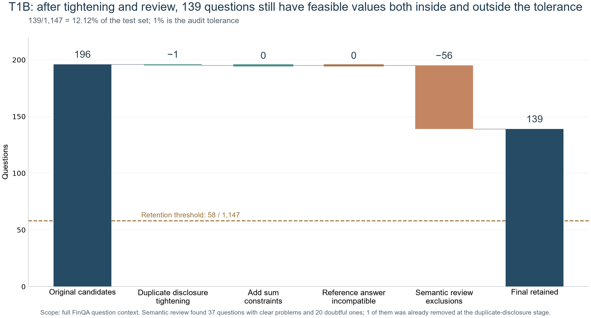

# T1B: tightening test with the full FinQA context

Date: 2026-11-16, America/New_York. The baseline is T1 commit `30acb8d`; no T1 files were modified. I chose to review only the full context provided by FinQA in this round, without extending to the full text of the original annual reports.

## Results

**The conclusion holds: 139 / 1,147 = 12.12%, above the threshold of 58 questions.**

All 139 questions satisfy three conditions: the input binding and program semantics passed this round's item-by-item review; there exists an out-of-tolerance rational witness that lies strictly inside all non-degenerate rounding intervals and satisfies the confirmed linear constraints; and there also exists an inside-tolerance witness satisfying the same conditions. So for these questions it really is the case that "with the same displayed information, the result can be inside the acceptance interval or outside it"; this is not merely treating an overly wide interval envelope as a counterexample.

This is still **an existence result under the rounding model**. It is not the probability that the answer is usually wrong, not a model error rate, and not a FinQA annotation error rate. The relative 1% here is the audit rule carried over from T1; the [official FinQA executor](https://github.com/czyssrs/FinQA/blob/0f16e2867befa6840783e58be38c9efb9229d742/code/evaluate/evaluate.py) compares the final value after rounding to five decimal places, so 1% cannot be written up as the official rule.



|Step|Removed at this step|Remaining candidates|
|---|---:|---:|
|T1 original test out-of-tolerance witnesses|—|196|
|Intersect duplicate disclosures of the same fact|1|195|
|Add confirmed sum, difference and roll-forward equations|0|195|
|Whole tightened interval incompatible with gold, listed separately|0|195|
|Exclude the remaining clear semantic problems and doubtful questions|56|139|

Duplicate disclosures narrowed the input boxes of 3 questions; further linear relations narrowed the output ranges of 9 questions, but no additional question moved entirely inside the 1% tolerance. **Tightening was not without effect; most of the tightening simply did not change this round's binary decision.**

The mutually exclusive attribution is: 139 retained, 1 numerically determined by duplicate disclosures, 0 numerically determined after sums, 0 incompatible with the reference answer, 37 clear semantic problems, 19 other doubtful. The semantic review total is actually 37 clear problems and 20 doubtful; of these, the 1 doubtful MSI question was already removed at the duplicate-disclosure stage and must not be deducted twice. The machine-readable files keep both the "semantics-first classification" and the "waterfall-order classification".

## Data and review coverage

Pinned FinQA upstream commit `0f16e2867befa6840783e58be38c9efb9229d742`, all 1,147 test questions. Rerunning the original T1 code gives: 196 `witnessed_outside`, 532 `certified_inside`, 3 `unresolved`, 416 `excluded`; the 196 witness IDs are identical to the existing results. SHA-256 hashes of the original inputs and the T1 results are saved in [manifest.json](manifest.json).

This round checked all of `table_ori`, `pre_text` and `post_text` for each of the 196 questions, item by item, and did not treat `gold_inds` as the only usable material. For each operand we checked the metric, entity, period, unit and quantity type; repeated sources of the same economic fact require semantic evidence and cannot rest on numeric coincidence or interval overlap alone. In total, 21 additional disclosures of the same fact were recorded, involving 13 questions; most have the same precision as the original source. The scan also allowed unit scaling and sign conversion, for example a negative profit/loss in a table versus a positive loss magnitude in the text.

The tables automatically yielded 801 candidate numeric relations (A 500, B 301), allowing the rounding half-widths of the items to cover the displayed residual. After item-by-item semantic review, **511 linear relations involving 143 questions** were finally adopted; these also include component totals, differences and same-fact links stated explicitly in the text, so they do not correspond one-to-one to the candidates. In the relation inventory, several questions cite the same reported relation, so 511 is not the number of independent economic identities.

Non-exhaustive wording such as "primarily due to" and "significant components include" was not treated as a complete bridge; the cross-review therefore removed a set of relations for PM, 7 equations for AMT, and a credit-facility decomposition for CME whose exhaustiveness could not be confirmed. The CME result under the strong assumption is saved separately as a sensitivity analysis and does not enter the main analysis. Missing entries were also not automatically treated as zero: the zero-value interpretations and intervals that were kept are recorded item by item. Multi-level table headers were checked by original physical position, and year-label errors were handled separately from genuine binding errors.

[review_a.json](review_a.json) and [review_b.json](review_b.json) are the complete review worksheets; the corresponding Markdown files are easier to read. The [per-question summary](results/question_summary.csv) and the [constraint inventory](results/constraint_inventory.jsonl) can be filtered directly.

## Fixed 40-question review and revision of the inclusion rules

Sorted by ID and drawn with Python `random.Random(20261116).sample(..., 40)`; the list is in [sample40.json](sample40.json). Of the 40, **27 passed, 8 had clear problems, 5 were doubtful**.

The fraction with clear problems is 20%; if the doubtful ones are also counted as not passing, it is 32.5%. The two must not be lumped together as an "error rate". In response to the task's one-quarter risk threshold, this round took the conservative route: rather than passing on the grounds of 8/40, it extended the review to all 196 questions and recomputed after revising the inclusion conditions. The sample fraction was not multiplied up to the whole set, and gold was not privately rewritten to fit the question.

The revised inclusion requirements are:

- Fixed years, numbers of years, contract terms, policy targets, declared dividends per share or unscaled exact counts must not be given half-a-last-digit-unit noise just because they are displayed as integers or decimals.
- The metric, year and unit of the source must match the operand's role; million/billion conversions must already be done in the program.
- The period and base period of a growth rate, the numerator and denominator of a ratio, and the number of periods in a sum must match the question; using a different metric or omitting an item cannot be attributed to rounding.
- A weighted-average recognition period cannot automatically determine the first-year expense; if the question asks for no average annualization and there is no assumption of uniform recognition, mark it doubtful.
- Questions whose meaning or source still cannot be confirmed are all excluded; we do not infer in the favorable direction.

Concrete examples: CME/2017/page_89.pdf-4 binds the exact divisor "3 years" to a 3.0% tax rate; LMT/2014/page_77.pdf-3 divides 1.3 billion by 804 million and misses the conversion; ETR/2016/page_150.pdf-4 asks about three years but adds only two; STT/2009/page_25.pdf-2 inverts the year and the denominator. Every problem has a per-question reason.

`replay_t1.py` freshly reruns the original source/program rules on all 1,147 questions, and then applies the explicit review records for the 196 questions as this round's inclusion revision. 139 questions passed semantic review, and all of them kept both an inside-tolerance and an outside-tolerance feasible witness. **This is not a full-text semantic acceptance of the other 951 questions, nor a finished general-purpose financial semantic parser.**

The review was read item by item and cross-checked by model sessions, with the main pipeline reviewing the evidence and computations; it is not an independent human sign-off. The 40-question worksheet is saved in full in [sample40_review.csv](results/sample40_review.csv) for later human acceptance.

## Numerical method and reliability

Each bound input, and each auxiliary fact involved in a constraint, is represented as an exact rational interval. Duplicate disclosures are converted to a common unit and intersected, and the same fact shares a variable; table components and totals both keep their own rounding intervals. Sum equations act on the hidden values rather than forcing the displayed centers to add up exactly.

Affine objectives are solved directly as LPs; linear-fractional objectives use the Charnes–Cooper transformation. HiGHS only provides candidate solutions: the primal solution, the dual lower bound and the residual correction are all re-verified with `Fraction`. Any rational dual multipliers give a reliable outer bound; only when a feasible endpoint attains the certificate bound do we call it an exact extremum. For nonlinear programs, a reliable coordinate envelope is computed first, and then the endpoints are checked for feasibility and attainment of the bound; the 5 nonlinear programs in this cohort also completed this certification.

In the end, **all 196/196 tightened ranges have exact-extremum certification**. All 588 stage results were also re-read from disk and verified by `verify_saved.py`, without calling the optimizer. The 139 retained inside/outside witness pairs were likewise checked item by item; no retained conclusion relies on an infeasible constraint set, an unresolved solve, or a rounding endpoint. [solver_notes.md](solver_notes.md) gives the proofs and boundary conditions.

The computational framework follows existing ideas for handling rounding intervals and duplicate facts: [XBRL Calculations 1.1](https://www.xbrl.org/Specification/calculation-1.1/REC-2023-02-22+corrected-errata-2024-02-14/calculation-1.1-REC-2023-02-22+corrected-errata-2024-02-14.html) §5.2, §5.4–5.7. The method is not a new theorem of this study.

## Four cases that can be checked directly

|Question|Change|Conclusion|
|---|---|---|
|BLK/2014/page_120.pdf-4|The exact growth-rate range for 137 and 133 is still `[2/89, 2/53]`, about 2.247%–3.774%.|Duplicate disclosures and table constraints did not remove the problem.|
|ADBE/1999/page_64.pdf-2|The text's 0.8 million total and the table's 772 thousand are the same balance; the ratio range shrinks from `[7/17, 3/5]` to `[140/309, 900/1543]`.|Clearly narrower, but can still cross the 1% tolerance.|
|MSI/2008/page_69.pdf-2|The text's loss magnitudes of 1.2 and 2.2 billion can be tightened by the table's 1,201 and 2,199 million, and the range becomes `[-1998/2401, -1994/2403]`.|Numerically inside the tolerance, but the question's "decline" versus the growth in losses is a semantic problem, so it cannot be treated as a clean repair case.|
|CME/2010/page_69.pdf-2|Only under the additional assumption that the two items exhaust the total credit facilities can the term loan of 420.5 plus the revolver of 945.5 million replace the roughly 1.4 billion; under the strong assumption the ratio range is `[18909/27320, 18911/27320]`, about 69.21%–69.22%.|Under the strong assumption the whole range is above the tolerance around the original gold of about 67.536%; but the original "including" cannot prove a complete decomposition, so the main analysis does not impose this equation and keeps the question.|

MSI also has a reported 83% increase in losses; after conversion to the program's sign convention, its rounding interval covers the tightened range in the table above, so it does not change this numerical decision. The question is still finally treated as semantically doubtful.

## Conclusions that can be drawn, and work this cannot replace

The permitted statement is: **in the full FinQA question context, after tightening with the duplicate disclosures and linear accounting constraints confirmed in this round, at least 139 test questions still have semantically reviewed rounding witnesses that cross the relative 1% acceptance interval.** The fraction uses all 1,147 questions as the denominator, but "at least" is still conditional on the stated rounding model and the listed constraints; it is not a proof of completeness with respect to all semantic constraints that were not extracted.

It cannot be rewritten as: the full text of the original annual reports necessarily contains no more precise information; 17% or 12% of questions are usually answered wrongly; or the benchmark must accept some model output. FinQA can define the displayed numbers themselves as arithmetic inputs; now that T1B's falsification test has passed, T1C still needs to test whether this actually changes model scoring.

In addition, this round did not exhaust nonlinear disclosure constraints such as products and ratios, and did not use the original XBRL taxonomy to prove relation semantics automatically. The remaining work is an independent human review of the worksheets and T1C; we do not claim that this round completed these tasks.

## Replication

Environment: Python 3.12.14, SciPy 1.18.1, SymPy 1.14.0, Matplotlib 3.11.2. Versions and code hashes are in [run_environment.json](results/run_environment.json). The raw data is not committed again; first obtain the pinned version with T1's downloader.

```powershell
python -m pip install -r research/t1b_tighten/requirements.txt
python research/t1_rounding/download_inputs.py
python research/t1b_tighten/prepare.py
python research/t1b_tighten/replay_t1.py
python research/t1b_tighten/run_audit.py
python research/t1b_tighten/verify_saved.py
python -m unittest discover -s research/t1b_tighten -p "test_*.py"
python research/t1b_tighten/deliver.py
```

The review JSON files are versioned semantic inputs; replication does not randomly regenerate judgments. `prepare.py` rebuilds the fixed sample, the data bundle and the numeric candidates; `verify_saved.py` can independently replay the certificates on existing results. Plotting uses Windows Microsoft YaHei by default; `T1B_FONT_PATH` can point to a local Chinese font instead.
