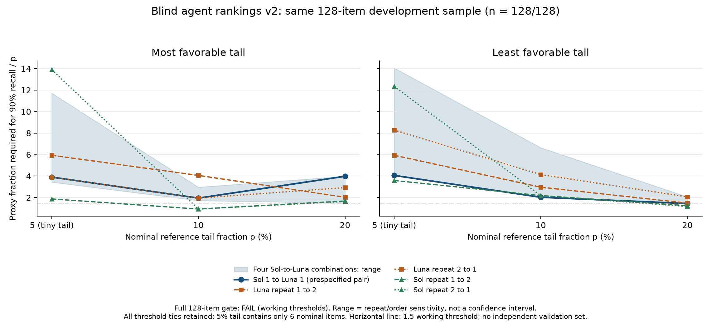

# Tail-screening trial run with isolated model sessions

2026-11-16 · Continuing the second-version research direction

**Conclusion: the trial was actually run; the current long-list grouped ranking method failed the scale-up conditions.** Two model tiers Luna / Sol, two input orders and two prompt rounds gave 8 isolated scoring sessions in total, and all raw outputs were saved. Using the local SEntFiN test split, 128 distinct lexical families were drawn with a fixed rule, one entity–headline sample each; the input hid human labels, old predictions and research expectations. No model was trained.

The first-round prompt wrongly evaluated every entity by "financially favorable to shareholders", while the data include regulators, currencies, places and institutions that are news sources. Sol's two runs had 20 and 2 unrankable items respectively. After the correction to target-entity financial text sentiment, all four new outputs covered the 128 items completely; this correction used the same development sample, so it cannot be called independent validation.

**The real problem appears in the same-model repeat.** After the correction, Sol's two runs have an overall rank correlation of **0.925**, yet the most negative nominal 10% lists have **12 and 14 items, overlapping in only 1**; at the positive tail, the two lists have 12 items each and overlap in 11. Luna's two runs produced only **11 and 9 distinct levels**, and because of ties the nominal 10% positive lists expanded to 25 and 14 items and the negative lists to 26 and 29. So the current measurement has insufficient resolution and repeat stability; these fluctuations cannot be attributed to the model tier, nor only to input position.

For a 90% recall target, the nominal 10% widening factors over the four cross-model combinations range over **1.72–2.97** at the positive tail and **2.03–6.64** at the negative tail. All boundary ties are kept, the denominator uses the nominal p, and the actual list sizes are reported separately. The ranges in the figure show this run's sensitivity to reordering and repeat runs, and **are not confidence intervals**. 5% has only a nominal 6 items, and 1% was not estimated; no asymptotic α was fitted, and the reference model is not objective truth.

**Decision: stop scaling up this specific measurement method, and keep the original tail hypothesis as untested.** Having agents rank the complete list directly did not provide the stable document-level signal of the original API logprob plan. Pairwise comparison or multi-permutation aggregation are alternatives that can be validated separately; existing ranking research also records order inconsistency and intransitive comparisons, so it cannot be guaranteed in advance that they solve the problem. [Qin et al., 2024, §3](https://aclanthology.org/2024.findings-naacl.97.pdf); [Tang et al., 2024, §§2–3](https://aclanthology.org/2024.naacl-long.129.pdf). What this result rejects is scaling up the current long-list method; it does not reject all agent methods or prove the original research hypothesis wrong.

The completed theoretical conclusions still apply: a general conditional-extremes assumption usually gives only $`q_\gamma=p^{\alpha+o(1)}`$, α=1 does not guarantee a constant factor, and the Gaussian α=ρ² has clear prior work. Full materials: [trial design, original prompt and results](agent_pilot.md) · [recomputable code](analyze_agent_pilot.py) · [second-round numbers](agent_pilot_results_v2.json) · [basis for the ranking method](agent_ranking_method.md) · [mathematical derivation](theory.md) · [four-branch prior-art check](literature.md).
