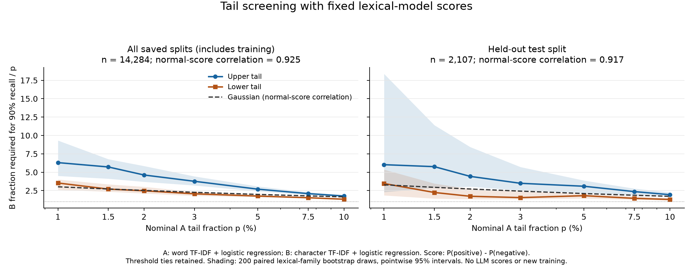

# What does a cheap model miss in the tail

**Later update: the trial run was completed with several isolated model sessions. For the latest measurements see the [one-page agent result report](agent_result_one_page.md). The text below is kept as the first-round report on theory and the lexical baseline from before the switch; the trial run needed no separate API connection.**

2026-11-16 · First-round results of the second-version direction

**Recommendation: narrow the claim and keep one low-cost API trial run; at present this is not enough to declare that the new theory direction holds.** [Copula modeling of LLM cascades](https://arxiv.org/html/2501.09345v3), [tail dependence characterizing extreme prediction ability](https://arxiv.org/html/2407.11887v2) and [recall-constrained proxy screening](https://ddkang.github.io/papers/2020/supg-paper.pdf) all have prior work. In the original papers read, we found no complete duplicate of "fixed-recall widening regularity + two-tail out-of-sample measurement on financial LLMs", but the full text of Yeo–David (1984) has not been obtained. Merely inverting a conditional-extremes model into a power law is not yet enough to be an independent theoretical contribution.

**The law has to be rewritten.** Let $`q_\gamma(p)`$ be the cheap model's upper-tail pass-through rate needed to keep a fraction $`\gamma`$ of the reference model's top $`p`$. Under Laplace margins, a finite tight residual and suitable quantile conditions, $`B=\alpha A+A^\beta Z+o_p(A^\beta)`$ with $`\beta<1`$, $`\alpha>0`$ gives

```math
q_\gamma(p)=p^{\alpha+o(1)},
```

and does not in general give $`q_\gamma\sim Cp^\alpha`$. **Even with $`\alpha=1`$, the widening factor can diverge**; the derivation memo gives a counterexample with exact Laplace margins. The positively correlated Gaussian $`\alpha=\rho^2`$ already appears in [HT (2004) §8.6](https://www.d.umn.edu/~yqi/mydownload/heffemantawn.pdf), and there are lower-order terms that affect finite thresholds; for any fixed $`0<\rho<1`$ the factor still diverges eventually. Here $`\rho`$ is the normal-score correlation, not the Pearson correlation of raw scores.



**The original table is reproduced, but it is still only a lexical baseline.** A=word, B=char, the score is $`P(positive)-P(negative)`$, pairing is by ID, and all ties at the threshold are kept. On the full sample of 14,284 items (including the training set), the factors at the top/bottom 1% are **6.31 / 3.54**, and the Gaussian baseline at a normal-score correlation of 0.925 is **3.02**. On the test set of 2,107 items, with only 21 items per tail: the factors are **6.03 [2.29,18.38] / 3.46 [1.86,5.36]**, and the Gaussian baseline is **3.29**. The shading is the pointwise 95% interval from a 200-draw paired lexical-cluster bootstrap; the models are fixed, and it does not cover event correlation or training uncertainty. The reference model is not objective truth.

In the 1%–10% window of the test set, the descriptive slope $`\alpha_{eff}`$ of $`\log\,q`$ against $`\log\,p`$ is **0.52 [0.03,0.89]** for the upper tail and **0.64 [0.42,0.89]** for the lower tail; the Gaussian slope in the same window is **0.72**. None of these is an estimate of the HT structural parameter, and they cannot be used to claim that a tail limit law has been validated.

**The next step addresses only whether the scores are usable.** The official API documentation supports obtaining token logprobs from Luna / Sol with reasoning off; the log-odds of two labels at the same position is a candidate score, and missingness, ties and the stability of repeated scoring still have to be measured. 100 items × 3 runs × two models is expected to cost about $0.05–0.11; 20,000 items for each of the two tiers about $3.40–7.60, estimated at 80–180 input and 1–2 output tokens per item, not including retries. A small trial read of the original authors' FNSPID data succeeded, but the file head is concentrated on a few stocks and cannot serve as a random sample; the license notes and sampling scope are in the memo. **There is currently no API key, paid scoring is zero, and there are no LLM experimental results yet.**

Full basis: [mathematical derivation](theory.md) · [four-branch prior-art check](literature.md) · [reproduction code](analyze_baselines.py) · [numerical results](baseline_results.json).
